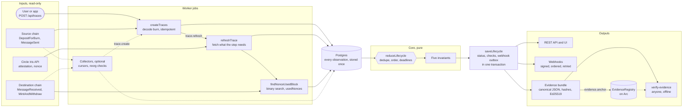

# ArcFlow Sentinel

ArcFlow Sentinel is a reliability layer for CCTP V2 USDC transfers between **Arc** and **Base**. It answers:

- Where is this transfer?
- Is it safe?
- What is the proof?

For each transfer, Sentinel:

1. Follows it from the burn on the source chain, through Circle's attestation, to the mint on the destination chain.
2. Reduces raw chain and Iris observations to a single lifecycle status.
3. Checks five invariants and flags transfers that are stuck or failed.
4. Exports a signed evidence bundle whose hash can be anchored on Arc.

It is not a block explorer. It never holds user funds. The only transactions it sends are its own evidence anchors.

## Why it's useful

A CCTP transfer touches three systems: a burn on the source chain, Circle's attestation service, and a mint on the destination chain. Each block explorer shows only its own piece. When a user asks "where is my money?", someone has to open three tools, match a nonce across them by hand, and still can't prove anything afterwards.

Sentinel does that work once, continuously, and hands back an answer:

- **One status instead of three explorers.** Paste a burn hash and see exactly which step the transfer is on, with chain links for every piece of evidence.
- **Problems are caught, not discovered later.** Deadlines per step flag transfers that are stalled (for example signed but never minted), and the five checks catch real failures: a wrong amount, recipient or route, or a double completion.
- **Proof that doesn't depend on trusting us.** Each trace exports a signed evidence file that anyone can verify offline, optionally anchored on Arc so its existence at that time is provable. That's useful for support tickets, disputes and audits.
- **Easy to build on.** A REST API and signed, ordered webhooks let exchanges, wallets and apps react to status changes instead of polling explorers.
- **Safe to run.** It's read-only: it never holds or moves user funds, and its only on-chain action is writing evidence hashes.

## What it does

- **Lifecycle:**
  - `SOURCE_OBSERVED → FINALITY_WAIT → ATTESTATION_PENDING → ATTESTED → DESTINATION_SUBMITTED → MINT_CONFIRMED → APPLICATION_CONFIRMED`.
  - Any stage can become `FAILED_OR_STUCK`: `STUCK` means a stage deadline passed (and it recovers if evidence arrives); `FAILED` means an integrity invariant failed (terminal).
  - One pure reducer decides status, so duplicate or out-of-order observations give the same result.
- **Invariants:** unique completion, value conservation (with explicit fees), recipient integrity, domain integrity, and a progress bound.
- **Evidence:**
  - An RFC 8785 canonical JSON bundle with its SHA-256 and keccak256, signed with Ed25519.
  - Anyone can verify it against the operator's published key with `verify-evidence`.
  - Unchanged evidence always produces byte-identical bundles.
- **Anchoring:**
  - The keccak256 goes to a tiny emit-only `EvidenceRegistry` contract on Arc.
  - The verifier can check the on-chain event against the recomputed hash.
- **Delivery:** a REST API (OpenAPI at `/api/openapi.json`), signed and ordered webhooks, and a web UI.

## Status

| Area                                                 | State                                                                                                                                                      |
| ---------------------------------------------------- | ---------------------------------------------------------------------------------------------------------------------------------------------------------- |
| Monitoring, lifecycle, invariants, API, webhooks, UI | Done. Verified against real mainnet transfers in both directions                                                                                           |
| Evidence bundles and verifier                        | Done                                                                                                                                                       |
| Anchoring                                            | Live on **Arc mainnet**: registry `0xD37a99DC7a7CA2E3b1A75648886875E50a6b52FF` (chain 5042). The same address on Arc testnet (5042002) is used for testing |

## Quick start

You need Node ≥ 22, Postgres 17 (or podman/docker to run it), and Arc and Base RPC endpoints.

```sh
npx pnpm@10.18.3 install
cp .env.example .env                                   # then fill it in
npx pnpm@10.18.3 --filter @sentinel/evidence keygen    # prints EVIDENCE_SIGNING_KEY: put it in .env
npx pnpm@10.18.3 --filter @sentinel/db migrate
npx pnpm@10.18.3 --filter @sentinel/worker seed-demo   # optional: two real historical transfers, offline
npx pnpm@10.18.3 --filter @sentinel/worker start       # job runner (+ collectors listed in COLLECT)
npx pnpm@10.18.3 --filter @sentinel/web dev            # http://localhost:3000
```

To run everything in containers, or to deploy to a VPS with HTTPS, backups and monitoring, follow [Self-hosting on a VPS](docs/self-hosting.md), or [at home behind a small VPS proxy](docs/self-hosting-ssh.md).

Trace a transfer by pasting its burn transaction hash into the UI, or with:

```sh
curl -X POST localhost:3000/api/traces -H 'content-type: application/json' \
  -d '{"sourceTxHash":"0x219163cb00c8535d2b3181d4ec4df21ebad0c88e1f6de4708722b735e132e41e","sourceChain":"base"}'
```

`docs/discovering-arc-to-base-transfers.md` lists more real transfers and explains how to find others.

### Verify evidence independently

```sh
curl -OJ "https://<host>/api/traces/<id>/evidence?download=1"
npx pnpm@10.18.3 --filter @sentinel/evidence verify-evidence sentinel-evidence-<id>-<hash>.json \
  --key-url https://<host>/.well-known/sentinel-key.json --anchor-tx <anchor tx hash>
```

The verifier:

1. Recomputes the canonical bytes and both hashes.
2. Checks the signature against the **published** key, never the key embedded in the bundle.
3. With `--anchor-tx`, checks that the published registry emitted `EvidenceAnchored` for this trace with the recomputed hash. It reads the chain over its public RPC by default.

Exit codes: 0 valid, 1 invalid, 2 usage error.

## Architecture



**How a transfer moves through it:**

1. A burn hash arrives, from a user, an app, or the optional collectors. Sentinel decodes the CCTP burn from the source receipt and stores it.
2. The `trace.refresh` job asks Iris for the attestation, which carries the nonce Circle assigns. With the nonce, it finds the exact destination block by binary search over `usedNonces`, so no wide log scans are needed.
3. Every observation is stored once. The pure `reduceLifecycle` function turns the stored set into one status and five check results, independent of arrival order or duplicates.
4. Each status change is saved together with its webhook outbox entries. The UI and API read the result, and evidence bundles are sealed from the same data and optionally anchored on Arc.

| Package              | Role                                                                                                           |
| -------------------- | -------------------------------------------------------------------------------------------------------------- |
| `packages/core`      | Pure domain logic: CCTP V2 decoding (ABIs verified against mainnet logs), the lifecycle reducer and invariants |
| `packages/chains`    | Arc and Base route config sourced from official docs, viem clients, and log, nonce and anchor helpers          |
| `packages/db`        | Drizzle schema and migrations, idempotent repositories, the Postgres job queue (`SKIP LOCKED`), rate limiting  |
| `packages/evidence`  | Canonical JSON, hashing, Ed25519, and the `verify-evidence` and `keygen` CLIs                                  |
| `packages/contracts` | `EvidenceRegistry.sol`, compiled with solc-js, EVM unit tests, and the viem deploy script                      |
| `packages/config`    | Environment validation and secret redaction                                                                    |
| `apps/worker`        | Trace pipeline, collectors, webhooks and anchoring jobs                                                        |
| `apps/web`           | REST API and UI                                                                                                |

The design decisions behind this are recorded in [`docs/adr/`](docs/adr/). [`docs/threat-model.md`](docs/threat-model.md) covers what can go wrong and how each risk is handled.

## Development

```sh
npx pnpm@10.18.3 test          # all packages; db and worker tests start Postgres via testcontainers
npx pnpm@10.18.3 typecheck
npx pnpm@10.18.3 lint
npx pnpm@10.18.3 --filter @sentinel/web build
```

`CLAUDE.md` has the full command reference and conventions.

## Limitations

- **Route:** Arc ↔ Base only, for CCTP V2 Standard and Fast burns of USDC. Gateway, StableFX, CPN and other bridges are out of scope.
- **Read-only:** no automated recovery or resubmission. Sentinel reports a stuck transfer; it does not fix it.
- **Anchor network:** the registry has the same address on Arc mainnet and testnet, so an anchor is identified by (chain id, tx hash). The verifier enforces the chain id published in `/.well-known/sentinel-key.json`. Testnet anchors are labelled as such in the UI.
- **RPC trust:** detection is only as good as the RPCs and the Iris API. Conflicting observations are flagged as anomalies and never produce a FAILED verdict. Cross-checking several RPCs is not implemented.
- **Free-tier RPCs:** these often cap `eth_getLogs` at about 10 blocks. Tracing doesn't need wide scans: mints are located by binary search over `usedNonces`. Passive collection (`COLLECT`) costs about 21k log calls a day at that span.
- **Fee-bearing fixtures:** the recorded transfers all have a fee of 0. Fee accounting is tested with derived fixtures.

## License

MIT. See [LICENSE](LICENSE).
